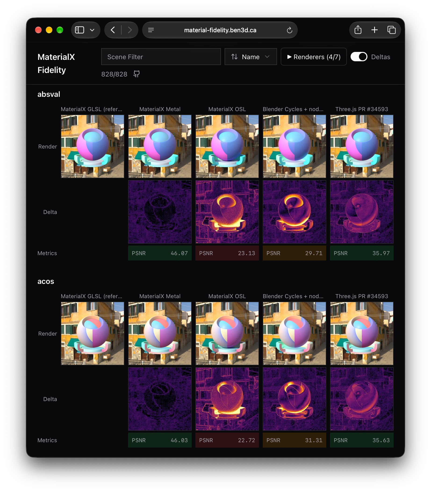

<p align="center">
  <a href="https://npmjs.com/package/fidelity-kit"></a>
  <a href="https://www.npmtrends.com/fidelity-kit"></a>
  <a href="https://codecov.io/gh/bhouston/fidelity-kit"></a>
  <a href="https://discord.gg/fwupDN493R"></a>
  <a href="https://fidelity-kit.ben3d.ca"></a>
</p>
<br/>

# fidelity-kit

> Compare renderer output without building a comparison site.

- 📊 PSNR Metrics per Comparison
- 🔥 Visual Delta Images
- 🖼️ Browsable Side-by-Side Viewer
- ⚡ Live-Reloading Dev Server
- 📦 Static Site or Docker Serving
- 🎞️ Temporal Fidelity and Benchmarks

fidelity-kit turns a folder of AVIF renders into image quality metrics, visual difference images, and a browsable website. Use it for rendering fidelity suites, visual regression reviews, and side-by-side comparisons of a renderer against one or more references.

Your renderer writes images; fidelity-kit handles the comparisons and viewer. Run the viewer locally while developing, serve the results from a container, or export a static site.

**[Read the documentation](https://fidelity-kit.ben3d.ca)**.

## Quick start

Put your renders in a results folder, then run:

```sh
npx fidelity-kit dev results
```

Open the URL printed by the command (usually <http://localhost:3000>). `dev` processes stale images, watches for new or changed renders, and reloads the viewer. See the [working example](https://github.com/bhouston/fidelity-kit/tree/main/examples/demo) for a complete suite.

A suite is a `results` directory with a `fidelity.json` and one image per renderer under each scene and output:

```text
results/
  fidelity.json
  materials/brushed-metal/beauty/reference.avif
  materials/brushed-metal/beauty/my-renderer.avif
```

```json
{
  "title": "My Renderer Comparisons",
  "renderers": [
    { "id": "reference", "label": "Reference", "reference": true },
    { "id": "my-renderer", "label": "My Renderer" }
  ]
}
```

## See it in action

[Material Fidelity](https://material-fidelity.ben3d.ca) uses fidelity-kit to compare renderer output side by side, with visual deltas and PSNR metrics.

[](https://material-fidelity.ben3d.ca)

## Learn more

- [Suite format](https://fidelity-kit.ben3d.ca/docs/suite-format): scenes, outputs, renderers, scene metadata, READMEs and logos.
- [Local development](https://fidelity-kit.ben3d.ca/docs/local-development): `process`, `dev`, `serve`, how comparisons stay current, and progress output.
- [Temporal fidelity](https://fidelity-kit.ben3d.ca/docs/dynamic-fidelity): score animated sequences for ghosting, flicker and convergence.
- [Rendering suites](https://fidelity-kit.ben3d.ca/docs/rendering-suites): capture renders from a registry, benchmarks and history, grouped selections.
- [Serve from Docker](https://fidelity-kit.ben3d.ca/docs/docker) and [publish a static viewer](https://fidelity-kit.ben3d.ca/docs/static-publishing).
- [CLI reference](https://fidelity-kit.ben3d.ca/docs/cli) and [API reference](https://fidelity-kit.ben3d.ca/docs/api).

## Releases

See [RELEASING.md](https://github.com/bhouston/fidelity-kit/blob/main/RELEASING.md) for how releases are published and [GitHub Releases](https://github.com/bhouston/fidelity-kit/releases) for changes.

## Contribution

See the [Contributing Guide](https://github.com/bhouston/fidelity-kit/blob/main/CONTRIBUTING.md).

## License

MIT

## Author

[Ben Houston](https://ben3d.ca), Sponsored by [Land of Assets](https://landofassets.com).
